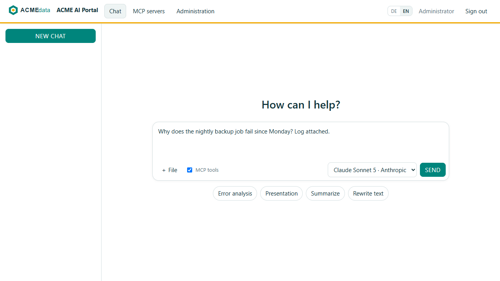
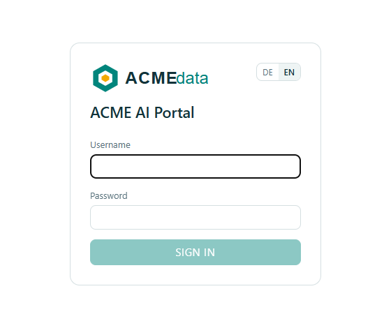

# Configuration reference

All settings are environment variables, validated on start (the process exits with a clear message if a required value is missing or invalid). Booleans accept `true` / `false`. In Kubernetes, put secrets into the Secret and everything else into the ConfigMap.

Provider credentials, AI models, knowledge collections and sources are **not** environment variables — admins manage them in the UI and they are stored encrypted in the database.

## Core

| Variable | Default | Description |
| --- | --- | --- |
| `PORT` | `8080` | HTTP port |
| `PUBLIC_URL` | `http://localhost:8080` | External base URL. Used for the OIDC redirect URI, absolute links in MCP results and the webhook addresses of knowledge sources shown in the admin UI. |
| `DATABASE_URL` | `postgres://aiportal@localhost:5432/aiportal` | PostgreSQL connection string (pgvector required); the default has no password — set the full URL (or `PGPASSWORD`) |
| `SESSION_SECRET` | – (required) | ≥ 32 characters; signs session and OIDC flow cookies |
| `ENCRYPTION_KEY` | – (required) | 32 bytes, base64; AES-256-GCM key for stored credentials |
| `SESSION_TTL_HOURS` | `12` | Session lifetime |
| `COOKIE_SECURE` | `false` | Set `true` whenever the portal is served over HTTPS |
| `STATIC_DIR` | `../web/dist` | Directory of the built web UI (`/app/web` in the image) |
| `LOG_LEVEL` | `info` | pino log level (`debug`, `info`, `warn`, `error`) |

## Outgoing connections

Node.js settings, not validated by the portal. They apply to all HTTP calls made with `fetch` — AI providers, embeddings, MCP servers (see [Connecting LLM providers](llm-providers.md#network-proxy-and-certificates)).

| Variable | Default | Description |
| --- | --- | --- |
| `NODE_USE_ENV_PROXY` | – | `1` makes Node.js honor `HTTPS_PROXY` / `HTTP_PROXY` / `NO_PROXY`; without it the proxy variables are ignored |
| `HTTPS_PROXY`, `HTTP_PROXY` | – | Proxy URL, e.g. `http://proxy.acme.local:3128` |
| `NO_PROXY` | – | Hosts reached directly, e.g. `localhost,.acme.local,10.0.0.0/8` |
| `NODE_EXTRA_CA_CERTS` | – | PEM file with additional CA certificates (TLS inspection, internal endpoints) |

## Branding

The web UI can be switched to a corporate design without rebuilding the image:

| Variable | Default | Description |
| --- | --- | --- |
| `PORTAL_NAME` | `AI Portal` | Name in the top bar, on the sign-in page and in the browser tab |
| `PORTAL_LOGO` | – | Logo shown next to the name (above it on the sign-in page). A file is embedded as data URI (`.svg`, `.png`, `.jpg`, `.gif`, `.webp`); an `http(s)://` URL is used as is and added to the CSP `img-src` (the browser must be able to reach it). |
| `PORTAL_THEME_CSS` | – | Stylesheet injected after the built-in styles. Override the CSS variables below; any other CSS rule is allowed, too. |

Both files are read once at startup; an unreadable file is logged as a warning and the built-in design is used. The design is served to everyone who opens the portal (also before sign-in), so do not put anything confidential into it.

All colors are CSS variables in the `:root` block at the top of [`web/src/styles.css`](../web/src/styles.css):

| Variable | Used for |
| --- | --- |
| `--bg`, `--bg-soft` | Page background; top-bar buttons, sidebar selection, chat bubbles, code blocks |
| `--fg`, `--muted` | Text colors |
| `--line` | Borders and dividers |
| `--accent`, `--accent-fg` | Primary buttons and the text on them |
| `--danger` | Errors, failed audit entries |
| `--font`, `--mono`, `--radius` | Font stacks, corner radius |
| `--logo-height`, `--header-logo-height` | Logo height on the sign-in page (40px) and in the top bar (26px) |

The built-in stylesheet switches these variables in a `@media (prefers-color-scheme: dark)` block. A plain `:root { … }` in the theme overrides both modes; add your own dark-mode block if the design should have one, or set `color-scheme: light` to keep form controls light.

[`examples/branding/`](../examples/branding) contains a complete example (fictional "ACME data" design: teal primary color, amber accent bar, own logo):

<table>
  <tr>
    <td width="70%" valign="top"><b>Chat with the example theme</b><br></td>
    <td width="30%" valign="top"><b>Sign-in</b><br></td>
  </tr>
</table>

Docker Compose mounts `BRANDING_DIR` (default `./examples/branding`) at `/branding`:

```bash
PORTAL_NAME=ACME AI Portal
PORTAL_THEME_CSS=/branding/theme.css
PORTAL_LOGO=/branding/logo.svg
```

In Kubernetes put the files into a ConfigMap, mount it at `/branding` (commented out in `deploy/k8s/deployment.yaml`) and set the variables in `configmap.yaml`:

```bash
kubectl -n ai-portal create configmap ai-portal-branding   --from-file=examples/branding/theme.css --from-file=examples/branding/logo.svg
```

## Bootstrap and local sign-in

| Variable | Default | Description |
| --- | --- | --- |
| `BOOTSTRAP_ADMIN_USER` | `admin` | Username of the first admin |
| `BOOTSTRAP_ADMIN_PASSWORD` | – | If set and the user table is empty, a local admin is created on start |
| `AUTH_LOCAL_ENABLED` | `true` | Allow sign-in with local accounts |
| `REGISTRATION_ENABLED` | `false` | Show a sign-up form on the login page (local accounts only; needs `AUTH_LOCAL_ENABLED`). New accounts stay inactive until an admin approves them |

## LDAP / Active Directory

| Variable | Default | Description |
| --- | --- | --- |
| `LDAP_ENABLED` | `false` | Enable LDAP sign-in |
| `LDAP_URL` | – | `ldaps://dc01.example.local:636` (recommended) or `ldap://…` |
| `LDAP_BIND_DN` | – | Service account used to search for users |
| `LDAP_BIND_PASSWORD` | – | Password of the service account (secret) |
| `LDAP_SEARCH_BASE` | – | Base DN for the user search |
| `LDAP_SEARCH_FILTER` | `(uid={{username}})` | `{{username}}` is replaced (escaped). Active Directory: `(sAMAccountName={{username}})` |
| `LDAP_ATTR_DISPLAYNAME` | `displayName` | Attribute for the display name |
| `LDAP_ATTR_EMAIL` | `mail` | Attribute for the email address |
| `LDAP_USER_GROUP_DN` | – | If set, only members of this group may sign in |
| `LDAP_ADMIN_GROUP_DN` | – | Members of this group become admins (synced on every sign-in) |
| `LDAP_GROUP_SEARCH_BASE` | – | Where to search for groups (`member`/`uniqueMember`) if the user entry has no `memberOf` |
| `LDAP_TLS_REJECT_UNAUTHORIZED` | `true` | Verify the `ldaps://` certificate. Only disable for tests. |

Group names are stored as the CN (`CN=IT-Team,OU=…` → `IT-Team`) and used for knowledge-base access. Nested AD groups are not resolved.

## OIDC (Azure AD / Entra ID, Keycloak, …)

| Variable | Default | Description |
| --- | --- | --- |
| `OIDC_ENABLED` | `false` | Enable SSO |
| `OIDC_ISSUER` | – | Azure: `https://login.microsoftonline.com/<tenant-id>/v2.0` |
| `OIDC_CLIENT_ID` | – | Application (client) ID |
| `OIDC_CLIENT_SECRET` | – | Client secret (secret) |
| `OIDC_SCOPES` | `openid profile email` | Requested scopes |
| `OIDC_DISPLAY_NAME` | `Microsoft` | Label on the sign-in button (“Sign in with …”); use a neutral name such as `SSO` or `Company login` if you do not use Entra ID |
| `OIDC_ROLE_CLAIM` | `roles` | Claim that carries roles (Azure app roles) |
| `OIDC_USER_VALUE` | – | If set, this value must be present in the role claim to sign in (e.g. `AiPortal.User`) |
| `OIDC_ADMIN_VALUE` | – | Value that grants the admin role (e.g. `AiPortal.Admin`) |
| `OIDC_GROUP_CLAIM` | `groups` | Claim with group names for knowledge-base access (role claim values are added too) |
| `OIDC_ADMIN_GROUPS` | – | Comma-separated groups whose members become admins (compared with the group and role claims, case-insensitive; Entra: group object IDs) |
| `OIDC_ADMIN_USERS` | – | Comma-separated admins by e-mail, `*@example.com`, or object ID (`oid`, else `sub`). Together with `OIDC_ADMIN_VALUE` / `OIDC_ADMIN_GROUPS`; the role is synced on every sign-in |
| `OIDC_ALLOWED_GROUPS` / `OIDC_ALLOWED_USERS` | – | Same format. If either (or `OIDC_USER_VALUE`) is set, only matching users — and admins — may sign in; everyone else is denied. Also enforced for OAuth tokens on `/mcp` |
| `OIDC_REQUIRE_VERIFIED_EMAIL` | `false` | `true`: match e-mails only if the provider marks `email_verified: true` (an e-mail marked `false` is always ignored). Leave off for Entra, which does not send the claim |

The same assignments can be managed at runtime in **Administration → Single Sign-On** (stored in the database, applied within seconds on every replica; entries from these variables are shown read-only). Entries marked *Admin* grant the admin role; plain entries form the allow list, which denies everyone else once it exists. Admin-only entries never restrict sign-in by themselves.

E-mail, `preferred_username` and `upn` are mutable attributes — for admins prefer the object ID, and keep the issuer to your own tenant.

Redirect URI to register at the identity provider: `<PUBLIC_URL>/api/auth/oidc/callback`. Azure returns group **object IDs** in the `groups` claim unless configured otherwise; using app roles or configuring group names ("sAMAccountName" in the token configuration) is easier to maintain.

## Chat, uploads and MCP

| Variable | Default | Description |
| --- | --- | --- |
| `UPLOAD_MAX_MB` | `20` | Maximum size per chat attachment |
| `MAX_TOOL_STEPS` | `8` | Maximum model ↔ tool round trips per answer |
| `MCP_ALLOW_PRIVATE_NETWORKS` | `true` | Allow user MCP servers on private IP ranges. Set `false` to block them (SSRF protection). |

## AWS Bedrock

| Variable | Default | Description |
| --- | --- | --- |
| `BEDROCK_TOKEN_TTL_SECONDS` | `3600` | Lifetime of the short-term Bedrock API keys of providers with *IAM role* (300–43200); never longer than the underlying AWS credentials, renewed 5 minutes before expiry |
| `BEDROCK_INFERENCE_PROFILE_PREFIXES` | – | Model list from the AWS account: only inference profiles with these ID prefixes, comma-separated, e.g. `eu.`; empty = all |
| `AWS_REGION`, `AWS_ACCESS_KEY_ID`, `AWS_SECRET_ACCESS_KEY`, `AWS_ROLE_ARN`, `AWS_WEB_IDENTITY_TOKEN_FILE`, … | – | Standard AWS SDK variables of the default credential chain used by *IAM role* providers (usually injected by EKS Pod Identity / IRSA) |

## Knowledge base

| Variable | Default | Description |
| --- | --- | --- |
| `KNOWLEDGE_ENABLED` | `true` | Enable the knowledge base, its admin UI and the `/mcp` endpoint |
| `KNOWLEDGE_WORKER` | `true` | Run the sync scheduler in this process |
| `KNOWLEDGE_FS_ROOT` | `/data/shares` | Mount root for file-share sources; paths outside are rejected |
| `KNOWLEDGE_MAX_FILE_MB` | `50` | Maximum size of a single source document or upload |

### OAuth 2.0 on `/mcp`

Besides personal access tokens, `/mcp` accepts OAuth access tokens from your identity provider (Entra ID, Keycloak, …). The portal is only the resource server: it validates signature (JWKS), issuer, audience and lifetime locally. The token's subject (`oid`, else `sub`) must belong to a user who has already signed in via OIDC (`OIDC_ENABLED`) — unknown or deactivated users get `401`. Groups for knowledge-base access are taken from the token (`OIDC_GROUP_CLAIM`, `OIDC_ROLE_CLAIM`); `OIDC_USER_VALUE` is enforced as for sign-in.

| Variable | Default | Description |
| --- | --- | --- |
| `MCP_OAUTH_ISSUER` | – | Issuer URL; enables OAuth on `/mcp` (`<issuer>/.well-known/openid-configuration` must exist). Entra: `https://login.microsoftonline.com/<tenant-id>/v2.0` |
| `MCP_OAUTH_AUDIENCE` | `OIDC_CLIENT_ID` | Accepted `aud` values, comma separated, e.g. `api://<app-id>` |
| `MCP_OAUTH_RESOURCE_SCOPES` | `<audience>/.default` | Scopes advertised to MCP clients (right for Entra; Keycloak: `openid profile email`) |
| `MCP_OAUTH_ALLOWED_ISSUERS` | `MCP_OAUTH_ISSUER` | Accepted `iss` values, e.g. Entra v1 tokens `https://sts.windows.net/<tenant>/` |
| `MCP_OAUTH_JWKS_URI` | discovery | Override the JWKS URL of the discovery document |

**Hardening (see [Security](security.md#oauth-and-sso-what-to-know)):** set a dedicated `MCP_OAUTH_AUDIENCE`, use an https issuer, allow exactly one issuer, and give MCP clients short-lived tokens. Only asymmetric signature algorithms are accepted. The portal logs `mcp oauth:` warnings at startup for an `http` issuer, a missing audience and several allowed issuers.

**What the identity provider needs** (the portal is only the resource server):

| Need | Details |
| --- | --- |
| Client registration | MCP clients need a client ID at the provider: Dynamic Client Registration (Keycloak; **not** Entra ID) or a pre-registered public client with PKCE, e.g. `claude mcp add --transport http --client-id <id> ai-portal https://<portal>/mcp`. Allow the client's redirect URIs (`http://localhost:<port>/callback` for Claude Code, `https://claude.ai/api/mcp/auth_callback`) |
| Audience | The access token must contain `aud` = `MCP_OAUTH_AUDIENCE`. Entra: scope `api://<app-id>/<scope>`; Keycloak: an *Audience* mapper |
| Groups / e-mail | `OIDC_GROUP_CLAIM` / `OIDC_ROLE_CLAIM` and the subject (`oid`, else `sub`) must be in the **access token** (Keycloak *Group Membership* mapper, Entra *groups* claim) |
| Scopes | `MCP_OAUTH_RESOURCE_SCOPES` must name scopes the provider knows (Entra: default; Keycloak: `openid profile email`) |

Unauthenticated requests get `401` with a `resource_metadata` link to `<PUBLIC_URL>/.well-known/oauth-protected-resource`, so clients that implement the MCP authorization spec (Claude Code, VS Code, …) can log in by themselves. Set `PUBLIC_URL` correctly.

## Audit

| Variable | Default | Description |
| --- | --- | --- |
| `AUDIT_LOG_PROMPTS` | `false` | Also store the full prompt / search text in audit entries. Clarify with data protection before enabling. |
